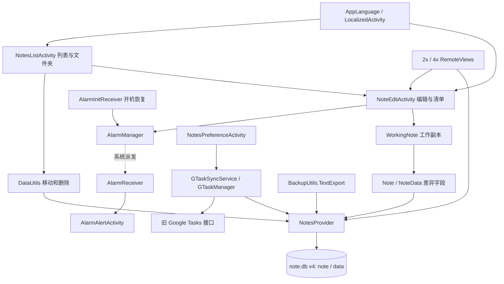

# 软件工程项目 REA 完整静态分析报告

分析日期：2026-10-23。工作区：`D:\SE\软件工程项目实验`。采用 `reverse-engineer-anything` 技能，REA 6.7.0、JADX headless MCP 0.7.1、Java 25.0.2。

## 1. 结论与分析边界

**JADX 已安装成功，已经实际完成 APK 解析、关键方法反编译和静态引用追踪。** 本轮不再停留在配置诊断。当前会话未提供 REA MCP 工具，因此直接使用本机已缓存的 REA 6.7.0 CLI；npm 启动缓存问题没有阻止分析，也未重新修改 Codex 配置。

项目的可交付主线是传统 Android 便签应用。交付的中文版属于实际 `frontend` 工作树；根目录 `源码/MiCode-Notes` 是另一版本。SmartTodo 是独立的待办与 AI 建议演示工程，当前证据不支持“已集成到交付便签”。Notesmaster 是 MiCode 同源变体。

最值得先处理的事项：

1. SmartTodo 的两项 API 凭据已经进入 APK；需要轮换并调整鉴权架构。
2. 便签保存链忽略失败结果，并在部分写入真正完成前清空差异数据；有保存结果误报和失败后难以重试的风险。
3. SmartTodo 的一个启动入口指向不存在的 Activity，待办数据也没有持久化。
4. 便签同步服务、导出的编辑入口存在可静态定位的异常路径；提醒、通知、存储仍有现代 Android 适配缺口。
5. 多工作树、多 APK、旧文档与实际工程存在漂移，需要明确发布来源和验收版本。

这里的“完整”指完成下表约定范围的静态审查，不表示反编译了第三方依赖的每一个方法，也不表示通过了运行验收。此次没有启动 APK、模拟器或账户登录，没有调用百度/Google API，没有重建 Gradle 工程，没有修改产品源码。

| 原始问题 | 本轮结果 | 证据边界 |
|---|---|---|
| JADX 是否真正能用 | 已回答 | REA 返回 provider 0.7.1，实际 APK LOADED 和方法结果 |
| 交付物身份、清单、类与版本关系 | 已回答 | 三份 APK；另核查明确工作树输出的哈希 |
| 便签创建/保存/搜索/删除/回收站 | 已回答静态机制 | 源码、DEX 方法与引用；未注入数据库失败 |
| 提醒、开机恢复、小组件、导出、同步 | 已回答静态机制 | 系统调度和服务端当前可用性仍待设备/网络验证 |
| 中文切换及编辑恢复 | 已回答静态机制 | 实际 frontend 源码和交付 APK 方法；未做设备重建测试 |
| SmartTodo 功能、凭据和启动配置 | 已回答静态实现与包内存在性 | 未联网检验凭据有效性、未伪造崩溃日志 |
| Notesmaster 与主工程差异 | 已回答 | 39 对 39 Java 文件、构建和测试入口对照 |
| 工程化、测试、启动与预览 | 已回答当前资产情况 | CheckOnly 检查通过；不是安装/启动验收 |
| 全平台运行、性能、同步成功率、可复现构建 | 未执行 | 见第 9 节验收清单 |

## 2. 工具验证与证据保存

实际提供器：

```text
REA_JADX_MCP_JAR=D:\REA\tools\jadx-headless-mcp-0.7.1-all.jar
JAVA_HOME=D:\javafile
JAR SHA-256=6e5eacf500b64292bfb73c49797c1958f6ee44646e43e868039ae7feb573ff75
JADX source revision=5844800a486d2248fa949b74c9896285f5b54de2
```

REA 使用单 worker、受控的 Java 分析子进程，APK 没有被执行。Windows 沙箱最初阻止子进程启动，获准在沙箱外运行分析器后成功。首次 package 证据 ID 为 `ev_1f249733ac612605f6f29711a72b93aeeb227fd83347774dc217f05d8bb8e654`。

保存了 **66 条成功的 REA Evidence、29 个方法反编译结果、3 次静态引用追踪**。完整输出保留 raw_result、normalized_result、目标摘要和 limitations；失败的类名探索记录没有计入成功数。

- [REA Evidence 清单](证据清单.md)：每条记录的完整 Evidence ID、操作、原始 JSON 链接。
- [方法反编译摘录](方法反编译摘录.md)：29 个方法结果，保留引擎状态和正文。
- [源码审查](源码审查.md)：MiCode/Notesmaster 精确行号、数据模型、差异和风险。
- [补充项目与工程化审查](补充项目与工程化审查.md)：SmartTodo、frontend、脚本与旧文档。
- [原始证据索引](证据/证据索引.json)、[源码文件摘要](源码证据索引.json)、[源码差异](源码差异.json)。

归档校验已通过：[校验结果](证据/校验结果.json)。66 条记录的目标摘要均匹配当前 APK，29 个方法 body_status 均为 available；原始 JSON 可解析，报告中的 Evidence ID 和文件链接有效，输出中未发现两项 API 凭据原文。它验证的是分析产物完整性，不是应用功能测试。

源码证据和本机 ZIP/DEX/哈希检查均单独标识，不冒充 REA Evidence。APK 签名真实性、split APK、native 库和运行时不是该 Android 提供器本轮验证的内容。

## 3. 项目与产物对应关系

| 工程/产物 | 实际角色 | 确认结果 |
|---|---|---|
| `源码/MiCode-Notes` | 39 Java 的迁移版主源码 | 本地 APK 与交付 APK 不同 |
| `.work/CSU_SE_TEST/repo` | frontend Android 中文版，42 Java | 分支提交 `9ce569894ef26d1a5e6365703f8eb2bba616be04`；现有 APK 与交付物逐字节相同 |
| `补充文件/Notesmaster-master/Notesmaster-master` | 39 Java 的 MiCode 同源变体 | 去注释/空白后 26 文件相同，13 文件 token 有差异 |
| `补充文件/SmartTodo-NoteCraft/Smarttodo-NoteCraft` | 8 Java 的独立待办/AI 建议演示 | 包名、SDK、界面与数据路径独立 |
| `.work/CSU_SE_TEST/code-optimization-zh` | 另一优化工作树 | 输出 APK 摘要不同；本轮只核查身份，未对该第四份 APK 反编译 |
| `.work/CSU_SE_TEST/feature-expansion` | 功能扩展工作树 | 指定 debug 输出不存在，不能据此确认扩展功能已交付 |

**实际 frontend 是 Android Java/XML 分支，并非 Web 前端。** 新增的 `NotesApplication`、`AppLanguage`、`LocalizedActivity` 在 frontend 存在，根目录 39 文件源码中不存在。哈希一致只证明现有两个 APK 文件相同，不证明当前源码可无差异重新构建出它，也不单凭 Git HEAD 证明构建输入干净。

| 被解析 APK | 字节数 | 包名 / SDK | JADX 类数 | ZIP 成员 / DEX |
|---|---:|---|---:|---:|
| `交付物/安装包/便签-中文版-debug.apk` | 2,073,474 | net.micode.notes / min21 target37 | 1698 | 162 / **9** |
| `源码/MiCode-Notes/app/build/outputs/apk/debug/app-debug.apk` | 2,018,598 | net.micode.notes / min21 target37 | 1695 | 161 / 9 |
| SmartTodo `app/build/outputs/apk/debug/app-debug.apk` | 7,061,520 | com.example.emptyactivity / min24 target34 | 3107 | 863 / 6 |

类数是 JADX 报告的包内类数量，包含依赖/生成类型，不能当作业务 Java 源文件数量。两份便签 APK versionName 均为 0.1，versionCode 均为 1；SmartTodo 的详细版本字段见 package 原始证据。

三份 APK 的 SHA-256：

```text
中文版  9C52E2508A8E021F6F7C208C7B0FE5E5418C6EF8D9FCCF8A9AB4203A34E3C250
根源码  84F1FD64308ADCCBFA61EA466CF5A462186DBCEC1FEB1FECFA8293ABA5EABE09
Smart   A0F12DA890DE40F943AAE831D14C953211E1102E2E3F569ED9D58D63DFA4246F
```

依据：[工作树 APK 哈希匹配](证据/apk-worktree-hash-match.json)、三份 `*-package.json` 与 `*-classes.json`。旧报告“10 个 DEX”已更正为 **9 个**。

## 4. 交付便签的架构与业务链



实线表示静态代码中的调用或数据关系；系统派发虚线不是 JADX 直接调用边。数据库 schema 在代码中创建，没有读取真实用户 note.db。

### 4.1 新建与保存

`NotesListActivity.createNewNote()` 创建 INSERT_OR_EDIT Intent；编辑器创建 WorkingNote，输入改变工作副本，`onPause()` 触发 Activity.saveNote → WorkingNote.saveNote → Note.syncNote。新便签先取得 note ID，正文由内部 NoteData 插入/更新 data 表，已有数据更新使用 applyBatch。保存后还可能通知小组件刷新。

静态引用追踪在 `classes7.dex` 找到 Activity.saveNote → WorkingNote.saveNote（DEX code-unit offset 5，method index 381）；在 `classes6.dex` 找到 WorkingNote.saveNote → Note.syncNote（offset 64，method index 75）。另一处 WorkingNote.saveNote 调用来自列表的应用说明初始化。它们是确实回收到的 DEX 调用，不是只按类名绘图。

引用证据：[WorkingNote 引用](证据/delivered-refs-model.WorkingNote.saveNote.json)、[Note 引用](证据/delivered-refs-model.Note.syncNote.json)。完整 Evidence ID 统一收录于 [Evidence 清单](证据清单.md)。

### 4.2 数据、搜索、删除与回收站

note 表保存层级、摘要、提醒、颜色、小组件与同步状态；data 表按 MIME 保存正文/通话信息。10 个触发器中 7 个与 note 关联、3 个维护正文摘要；涉及文件夹计数、摘要更新、关联删除和文件夹移入回收站后的子项处理。

不能把触发器描述为已经证明支持任意深度的“递归回收站”：实际行为还取决于允许的目录层级与 SQLite recursive_triggers。正常 UI 目录结构和触发器定义见源码附件。

搜索是摘要字段上的带通配符 LIKE 查询，并非专用 FTS 索引；关键词通过绑定参数传给 rawQuery。便签/文件夹删除及移动经 DataUtils、Provider 与触发器完成，回收站采用特殊父目录 ID。大数据量下的 LIKE 性能、文件夹计数一致性和部分失败恢复没有做压力/故障测试。

依据：[搜索方法](证据/delivered-method-data.NotesProvider.query.json)、[触发器注册](证据/delivered-detail-net.micode.notes.data.NotesDatabaseHelper.reCreateNoteTableTriggers0.json)、[源码审查](源码审查.md)。

### 4.3 提醒与开机恢复

设置提醒 → 确保便签 ID → 使用便签 URI 区分 immutable PendingIntent → `AlarmManager.set(RTC_WAKEUP)`。取消提醒调用 cancel。开机接收器查询未来 alert_date 再逐条注册；AlarmReceiver 收到后直接启动 AlarmAlertActivity。

这是本地持久化提醒，不依赖云同步。`set()` 不提供现代 Android 的准点保证，且 Receiver 直接拉起 Activity 受到后台启动限制。删除/回收站路径与开机查询对提醒的过滤和取消也需要补验收。

`trace_android_references(AlarmReceiver.onReceive)` 返回 0 个 using-node，并不表示提醒不可达：它是 Android 框架回调，Manifest、PendingIntent 和方法正文共同建立静态链路。反射、动态加载和系统调度不能由直接调用数穷尽。

### 4.4 小组件、备份与同步

- 小组件读取绑定 widget_id 的便签，构建 RemoteViews；有内容时打开编辑，没有内容时打开新建；隐私模式显示替代文本。移除小组件会将 widget_id 清零。2x/4x 子类依靠 AppWidgetProvider 的框架接收分发，不能因其没有自行声明 onReceive 就报告广播入口缺失。
- BackupUtils.TextExport 依次导出文件夹和根便签到 PrintStream；这是文本导出，不是已验证的完整数据库备份/还原。现代存储权限、外置路径可写性和导出失败处理仍需设备验证。
- Google 同步使用 GTaskSyncService、ASyncTask、Manager、Client 和同步数据模型。登录流程仍包含旧 Google Tasks 网页端点/账户 token 机制；有代码不代表今天仍能登录。没有调用任何账户，也没有把旧接口判为已实测可用或不可用。

依据为对应类清单及 `update`、`onDeleted`、`TextExport.exportToText`、`GTaskClient.login` 方法，全部可在 Evidence 清单检索。

### 4.5 语言切换与恢复

交付 APK 的 AppLanguage 对 Android 13+ 使用 LocaleManager，旧系统使用私有 SharedPreferences 和 Context 配置；LocalizedActivity 在旧系统检测语言变化并 recreate。编辑器 onCreate 优先取 Bundle 保存的便签 ID，之后加载模型再初始化界面；onSaveInstanceState 对未落库便签先保存，再保存 ID。

这说明恢复依赖数据库保存成功，并不是将全部草稿直接放进 Bundle。当前没有证据证明正常语言切换必然丢字；下面的失败回报问题会影响这条链，应以设备重建和失败注入检查。

## 5. 交付便签风险与修复方向

优先级 P1 表示优先修复，P2 表示应排入后续迭代；不是套用未计算的 CVSS 分值。

| 优先级 | 发现与触发条件 | 证据与影响 | 建议 |
|---|---|---|---|
| P1 | WorkingNote.saveNote 忽略 syncNote 返回值 | [保存方法](证据/delivered-method-model.WorkingNote.saveNote.json)，ID `ev_06d56e6a00ae15e92371991304d25da301c226ff638103d81b7caa2e4acf9a0f`；底层报告失败仍返回 true | 显式传播结果，失败保留草稿并提示重试 |
| P1 | 分步写 note/data，差异值在后续提交前清空 | [NoteData 写入](证据/delivered-detail-net.micode.notes.model.Note.NoteData.pushIntoContentResolver0.json)、[Note.syncNote](证据/delivered-method-model.Note.syncNote.json)、Provider 方法清单；未发现自定义 applyBatch 事务覆盖 | 用同一 Provider/SQLite 事务包住完整保存；成功后清脏；检查每个结果 |
| P1/P2 | START_STICKY 服务重建时 intent 可能为 null | [onStartCommand](证据/delivered-method-gtask.remote.GTaskSyncService.onStartCommand.json)，ID `ev_fdf071424618636acdfc01468e6607a0261cd2debe832068ee4501266c3544fe`；入口先 getExtras | 空值守卫，并确定是否需要自动重启同步 |
| P2 | exported 编辑器直接解析外部 EXTRA_DATA_KEY | [initActivityState](证据/delivered-method-ui.NoteEditActivity.initActivityState.json)，ID `ev_cfed4772f3f1466520b2a99ee84623e79c9ef565b2539545b5c677566dff5ab7`；非法字符串产生 NumberFormatException 路径 | 校验 action、ID格式和额外参数；安全返回 |
| P2 | onNewIntent 忽略初始化失败，模型可能已清空 | onNewIntent / initActivityState / onPause / saveNote 联合静态路径 | 失败立即终止后续处理，保存/回调判空；运行复现具体生命周期 |
| P2 | v1 → v2 数据库升级直接 DROP note/data | [upgradeToV2](证据/delivered-detail-net.micode.notes.data.NotesDatabaseHelper.upgradeToV20.json) | 改成保留数据的迁移，并用真实旧版本数据库测试 |
| P2 | 高 target 与旧提醒/账户/存储/通知流程并存 | APK target37 和源码适配缺口；没有运行时验收证据 | 按最低支持版本与最新目标版本逐项适配 |

保存风险的两个细节需要分清：note update 计数为 0 时只是日志；data 的新插入即使成功，未形成 batch 也会返回 null，导致内部失败结果含义不清。更新 batch 之前又已 clear 变更值，失败后数据难以原样重试。以上是实际 APK 中的控制流，不是已观察到用户数据丢失；也不能简单将返回值改为直接透传而不先修正其语义。

ContentProvider 继承的默认 applyBatch 不自动替自定义 SQLite 操作建立完整业务事务。单条 SQL/触发器的原子性不等于一次跨 note/data 保存的原子性。

Manifest 中 NoteEditActivity 导出，但 NotesProvider 在现代 target 下默认不导出，GTaskSyncService/AlarmReceiver 显式不导出。因此没有证据支持“任意应用直接读写全部数据库”或“公开 SQL 注入”的说法。交付 APK 是 debuggable 的 debug 包，适合作业演示；如需正式发布应另行建立 release 签名、版本和调试配置。

源码还发现联系人空结果 Cursor 关闭缺口、Provider increaseNoteVersion 手工替换参数、12 小时制标题分支回归、同步通知缺少频道等，精确位置见源码审查；没有全部追加为交付 APK 已验证缺陷。

## 6. SmartTodo 与 Notesmaster

### 6.1 SmartTodo

FirstActivity 动态增加待办卡片，点击进入 AdviseActivity；建议按钮启动线程，最多立即重试 5 次，经 RequestBodyGenerator、Sample、OAuth、聊天接口和 Gson 解析回到 UI。主页另一套多参回调已取消绑定，不能把未接入的旧重试代码当作实际主页链路。

| 优先级 | 发现 | 支持程度 |
|---|---|---|
| P1 | API_KEY、SECRET_KEY 硬编码，两个字面量均可在 APK DEX 中找到 | 源码与实际二进制布尔验证；未记录密钥原文，未检验有效性 |
| P1 | 双 MAIN/LAUNCHER，其中 com.example.emptyactivity.MainActivity 无类定义 | REA 清单/类检索 + 所有6DEX的 class_defs 检查相互支持 |
| P1 | 待办仅动态 View，缺少持久化与重建恢复 | 全部8Java的源码边界；没有仓储或 MiCode Provider 接入 |
| P2 | 每次点击新线程、立即重试、无取消/去重，静态共享响应变量有竞态 | AdviseActivity、Sample 源码控制流；未声称竞态已发生 |
| P2 | 缺少 HTTP/业务错误分类，输出完整响应，MediaPlayer 未释放 | 源码定向审查 |
| P2 | Groovy/Kotlin 两套构建脚本身份不一致 | 构建文本；实际 APK 身份由 Manifest 另行确定 |

建议先轮换凭据、将需要保密的上游鉴权移到服务端，再修正唯一启动入口和持久化模型。网络层使用局部响应、合理退避、有效 token 缓存和生命周期取消。

OkHttp `ResponseBody.string()` 正常读取后会关闭 body，本轮不把“没显式 response.close”当作已证实的正常路径连接泄漏。源码含 MainActivity 不代表清单指定的那个包名存在；此处已做精确全限定名核对。

证据：[原始独立校验](证据/supplement-source-package-audit.json)、[REA 包清单](证据/smarttodo-package.json)、[REA MainActivity 检索](证据/smarttodo-main-classes.json)、[补充审查](补充项目与工程化审查.md)。源码与 SmartTodo APK 也有部分差异，源码方法级发现不自动升级为包内运行事实。

### 6.2 Notesmaster

Notesmaster 没有新增 Java 业务模块，保留相同 39 文件路径。与主源码 13 处 token 差异主要是 Apache HTTP → HttpURLConnection、PendingIntent immutable、receiver 注册适配、菜单结构和控件父类等；不能将目录名或新增依赖当作 AI 功能集成证据。

主源码 compile/target37、min21、Java17；Notesmaster compile/target34、min28、Java8，构建配置不同。两者同为 net.micode.notes、authority=micode_notes，不能视作天然独立可同时安装的两个产品。

## 7. 工程化、测试与文档

主源码 app/src 下没有业务自动化测试；Notesmaster 和 SmartTodo 主要是模板算术/包名测试，不能证明数据一致性、提醒或 AI 请求可靠。存在历史运行截图和拉起手册，但它们不是本轮针对当前 APK 的执行证据。

启动脚本 `start-chinese-notes.ps1 -CheckOnly` 当前检查通过，确认指定 SDK、AVD 和 APK 文件存在；没有由此声称 Android 已启动或所有功能正常。

浏览器预览属于模拟器画面转发工具，不是便签 Web 实现。断连后旧 FRAME 未清、健康状态/页面可能仍报告已连接，应将“进程在线”和“设备画面新鲜”分开判断，展示最后帧时间与真实错误。

旧文档仍有“无构建脚本”、旧 `src/` 路径，以及“.work 可删”的说明。现在 `.work` 包含实际 frontend Git 工作树、AVD 和预览资产，不能按旧说明整体清理。最新拉起手册已纠正部分前提，建议统一入口文档并固定源码提交、构建配置、APK SHA 与操作截图的对应关系。本次仅登记漂移，没有清理工作树或修改旧说明。

## 8. 建议实施顺序

1. **先控凭据与来源**：轮换暴露凭据；标明正式主线为 frontend 的确切提交；给交付包附 SHA 和构建清单。避免再以根源码冒充中文版全部构建输入。
2. **修复数据与入口**：便签事务、结果传播和失败重试；SmartTodo 持久化与正确 Launcher；导出编辑器输入校验和空模型保护。
3. **适配平台**：同步服务 null Intent、通知频道/权限、后台提醒展示、联系人运行时授权和存储导出方式。
4. **整理网络与工程**：生命周期取消、退避、错误分类、响应日志脱敏；统一构建脚本，分支与 APK 版本可追踪，修订旧文档。

这些是后续修复建议，本轮没有擅自修改业务实现、撤销远程凭据、推送代码或重新发布 APK。

## 9. 尚需执行的验收

| 场景 | 最小验证动作 | 合格标准 |
|---|---|---|
| 保存可靠性 | 正常新建/修改重载；注入 note/data 中途失败 | 成功一致、失败回滚，草稿可重试且 UI 不误报 |
| 生命周期 | 中文/英文切换、旋转、后台进程重建、非法新 Intent | 草稿/ID一致，非法输入安全返回，无空模型崩溃 |
| 提醒 | 重启、Doze、锁屏、回收站/永久删除 | 提醒策略符合产品要求，已删便签不再无效唤醒 |
| 同步 | 用获授权测试账户登录、断网恢复、冲突/取消 | 协议当前可用，失败可诊断，不重复/覆盖错误 |
| SmartTodo | 点击每个图标、保存重启、连点建议/退出页面 | 唯一正确入口，待办可恢复，无旧页面回调 |
| 权限与备份 | 拒绝联系人/存储权限；导出大数据与写入失败 | 无崩溃，明确提示；导出结果可读且内容准确 |
| 构建发布 | 干净检出固定提交，构建并记录签名/依赖/输出 | 可重复执行的流程、明确 release/debug 和版本来源 |

尚未获得这些运行结果，因而不报告“全部功能测试通过”。静态调查已把需要验证的问题、触发点和证据位置具体化，后续无需重新从配置检查开始。

## 10. 复查方式

`运行静态分析.py`、`补充静态分析.py` 使用本机已缓存的 REA 6.7.0 CLI，逐次保存 JSON；成功记录优先复用。换机时需调整脚本内 REA 路径，并重新确认 APK 哈希再复用证据。`汇总证据.py` 从原始 JSON 生成清单和方法摘录；`supplement_audit.py` 只读检查补充 APK 和源码。

证据保存了引擎/目标身份和不完整覆盖说明。JADX 的 Java 文本是反编译表示，不是原始 Java 源码；方法源行号未知，DEX 偏移以 code unit 为单位。incoming-reference 的 complete 只对该引擎已恢复的 using-node 范围成立，不能扩展为运行时调用完整性。
