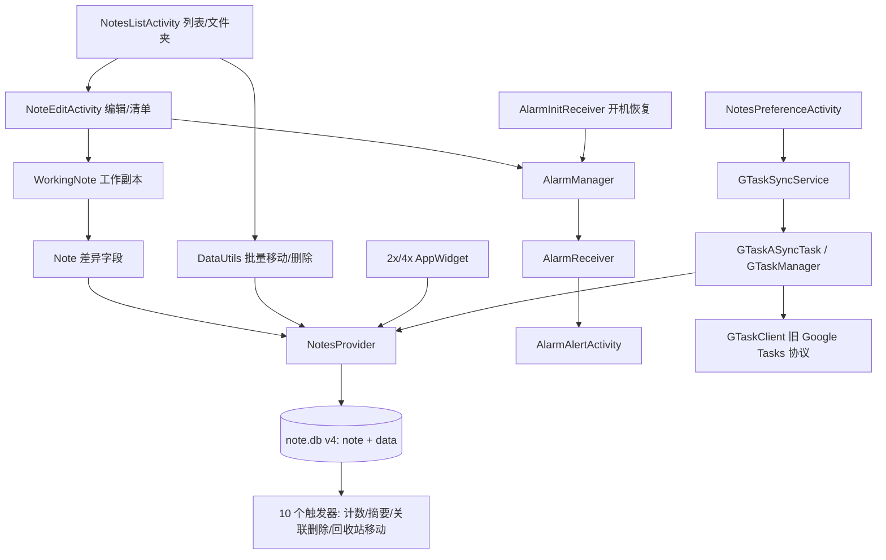

# MiCode Notes 与 Notesmaster 源码审查

分析日期：2026-10-23。此附件是源码静态审查，配合主报告中的 REA/JADX APK 证据使用；源码观察不等同于安装包已执行的行为。尤其保存实现、批处理和事务结论仅针对本次读取的主源码；不能直接归到交付 APK，必须另用其类/方法证据核实。

## 1. 范围与证据

主源码为 `源码/MiCode-Notes`；对照源码为 `补充文件/Notesmaster-master/Notesmaster-master`。两者 `app/src/main/java` 均有 39 个 Java 文件，相对路径集合完全相同。审查包含全部文件清单、Java 词法差异，以及保存、删除、搜索、提醒、小部件、Google Tasks 同步、备份、Manifest、构建和测试入口的定向阅读。未修改产品源码，未执行应用、联网登录或构建。

- [源码证据索引](./源码证据索引.json)：80 个源码/Manifest 文件的绝对路径、SHA-256、字节数。
- [源码差异](./源码差异.json)：忽略 Java 注释与空白、保留字符串和字符字面量后的比较结果。
- [比较脚本](./compare_source.py)：可重复执行的差异生成器。它不是 Java 编译器；token 相同支持“去注释/空白后相同”，不证明两套资源、构建、运行行为相同。

下文源码基准目录记为 **M** = `D:/SE/软件工程项目实验/源码/MiCode-Notes/app/src/main`，**N** = `D:/SE/软件工程项目实验/补充文件/Notesmaster-master/Notesmaster-master/app/src/main`。文件行号均为此次读取的一基行号，`java/` 下统一包路径为 `net/micode/notes/`。`SRC-*` 是本附件的源码证据标签，不冒充 REA Evidence ID。

## 2. 架构与主要链路

这是传统 Android Activity + ContentProvider + SQLite 架构，并非服务端/前端分离应用。

| 模块 | 已观察到的职责 | 源码证据 |
|---|---|---|
| `data`，4 Java | URI、数据库、Provider、联系人读取 | M `data/NotesProvider.java:53`，`data/NotesDatabaseHelper.java:31` |
| `model`，2 Java | 工作副本、字段差异、持久化 | M `model/WorkingNote.java:190`，`model/Note.java:103` |
| `ui`，14 Java | 列表、文件夹、编辑、复选清单、搜索入口、闹钟、设置 | M `ui/NoteEditActivity.java:182`，`ui/NotesListActivity.java:470` |
| `tool`，4 Java | 批量数据操作、文本备份、资源映射、同步字符串 | M `tool/DataUtils.java:40`，`tool/BackupUtils.java:317` |
| `gtask`，12 Java | 本地/远端节点、冲突版本、网络请求、同步任务/服务 | M `gtask/remote/GTaskSyncService.java:71`，`gtask/remote/GTaskClient.java:60` |
| `widget`，3 Java | 两种尺寸桌面便签，点击打开编辑器 | M `widget/NoteWidgetProvider.java:72` |

**SRC-01 数据模型。** `note.db` 版本 4，`note` 保存文件夹关系、摘要、提醒、颜色、小部件信息和同步状态；`data` 保存 MIME 类型、正文和通话扩展字段，并在 `note_id` 上建立索引。四个文件夹计数触发器、三个正文摘要触发器，以及关联 data 删除、子便签删除、子便签移入回收站共 10 个触发器。依据：M `data/NotesDatabaseHelper.java:31`、`:47`、`:70`、`:89`、`:139`、`:178`、`:189`、`:200`。源码未声明外键，也未显式设置 `PRAGMA recursive_triggers`；不能仅凭 SQL 宣称任意深度递归级联。UI 新建文件夹不指定父目录，使用默认根目录（M `ui/NotesListActivity.java:624`）。

**SRC-02 保存。** 编辑器在 `onPause` 取正文并保存（M `ui/NoteEditActivity.java:401`、`:799`）；`WorkingNote` 为非空新笔记分配 note 行，然后由 `Note.syncNote` 更新 note 元信息、插入/更新 data，data 触发器同步 note 摘要。已有正文/通话数据的更新通过 `applyBatch` 发出。自动保存和“已保存”返回值存在下述失败处理问题。

**SRC-03 删除与文件夹。** 未配置同步账户时直接删除；配置账户时改为移入 trash，以供同步处理。依据：M `ui/NoteEditActivity.java:579`、`ui/NotesListActivity.java:470`、`:507`。Provider 保护 `id<=0` 的系统文件夹；触发器负责正文和直属子便签关联操作。批量助手只检查结果数组/首项是否存在，未确认每项 `count>0`（M `tool/DataUtils.java:61`、`:100`）。因此返回 true 不等于每个选择项均成功删除/移动。

**SRC-04 搜索。** Provider 对 note.snippet 做 `%关键词%` LIKE，排除 trash 和非笔记类型，搜索词作为参数绑定；没有发现这一路径将搜索词拼接成 SQL。依据：M `data/NotesProvider.java:76`、`:129`。`%`、`_` 未转义，作为 LIKE 通配符起效；前置 `%` 一般需要扫描，未见全文检索索引。适合小型本地便签，数据量增长后需测量响应时间。

**SRC-05 提醒。** `setAlertDate` 通知编辑器，编辑器调用 `AlarmManager.set(RTC_WAKEUP)`；以 note URI 区分 PendingIntent；开机 receiver 查询未来提醒重新注册；闹钟 receiver 直接打开 Alert Activity。依据：M `model/WorkingNote.java:232`，`ui/NoteEditActivity.java:605`，`ui/AlarmInitReceiver.java:42`，`ui/AlarmReceiver.java:25`。静态链路存在，现代系统是否准时弹出和播放仍需设备测试。`set` 是非精确调度，不能宣传分钟级准点保证。

**SRC-06 小部件。** 2x/4x Provider 共用数据库读取/RemoteViews 逻辑；移除小部件后回写 note 的 widget 状态；点击打开编辑器；主项目已加 `FLAG_IMMUTABLE`（M `widget/NoteWidgetProvider.java:49`、`:113`）。隐私模式动作分支只说明存在处理逻辑，不证明现代系统会发送该非标准动作。

**SRC-07 同步与备份。** 同步走传统 Service/AsyncTask 和单例 GTaskManager，旧 `mail.google.com/tasks/ig`、`/r/ig` 接口及 HTML `_setup(...)` 解析，使用 AccountManager 获取账户授权。主项目网络客户端迁移到 HttpURLConnection，连接/读取超时为 10/15 秒；输入流在 finally 关闭。依据：M `gtask/remote/GTaskClient.java:60`、`:167`、`:191`、`:273`、`:283`、`:292`。并未联网验证接口仍可用。文本备份使用传统共享外置存储根目录（M `tool/BackupUtils.java:317`），现代 scoped storage 兼容性需核验。

## 3. 主要问题与优先级

### P1：保存失败可被上层当作成功，且没有跨表原子提交（SRC-08）

M `model/WorkingNote.java:199` 调用 `mNote.syncNote(...)` 却忽略其 boolean，随后返回 true（`:209`）。`Note.syncNote` 即使 note 元数据更新返回 0 也继续执行并清空差异（M `model/Note.java:117`、`:123`）；正文/通话字段在实际 `applyBatch` 之前就清空（`:211`、`:233`，实际调用 `:238`）。失败后用户界面可能认为保存完成，而重试所需的脏数据已经丢失。

还需注意：首次插入正文成功时，`pushIntoContentResolver` 没有批量更新项，最终仍返回 null（M `model/Note.java:192`、`:236`、`:250`）；这会让 `syncNote` 返回 false，但当前上层恰好忽略它。因此修复不能只把上层改成直接返回现有 `syncNote` 结果，还必须统一成功/失败契约。

Provider 没有重写 `applyBatch`，也没有 `beginTransaction`。note 行更新、新 data 插入、已有 data 批量更新是分开的调用，默认 ContentProvider 批处理不为自定义 SQLite 操作自动提供业务事务。依据：完整 M `data/NotesProvider.java:38` 至文件末尾、M `model/Note.java:117`、`:195`、`:238`。单条 SQL 及其触发器的事务能力不能扩展成整次“保存便签”原子性。

建议：Provider 事务覆盖所有关联操作；所有结果成功后再清空工作差异；检查每个更新计数；保存失败向 UI 返回错误并保留重试数据。需要注入 SQLite/Provider 失败验证，当前是可靠的源码控制流发现，未声称实机发生过丢失。

### P1：START_STICKY 服务的空 Intent 崩溃路径（SRC-09）

M `gtask/remote/GTaskSyncService.java:72` 无条件 `intent.getExtras()`，`:84` 返回 START_STICKY。系统重新创建这种服务时允许以 null Intent 调用 `onStartCommand`，当前代码会空指针。服务非导出，这不是外部任意调用漏洞；触发条件是系统服务重建等生命周期路径。建议空值守卫并明确是否应该自动续传。

### P1/P2：提醒、权限和通知的现代 Android 兼容性缺口（SRC-10）

- M targetSdk=37，源码仍通过 BroadcastReceiver 直接 `startActivity`（M `ui/AlarmReceiver.java:28`），需要验证当前系统后台 Activity 启动限制。调用 `AlarmManager.set` 也不能保证精确时间。
- 同步通知使用不含 channelId 的 `new Notification.Builder(mContext)`，未见创建 NotificationChannel；Manifest 也未声明 POST_NOTIFICATIONS（M `gtask/remote/GTaskASyncTask.java:76`；M `AndroidManifest.xml:20`）。对现代 target 的通知交付存在明确适配缺口，应设备验证并补建频道/权限流程。
- 主源码 Java 中搜索 `requestPermissions`、`checkSelfPermission` 无命中，但声明 READ_CONTACTS/WRITE_EXTERNAL_STORAGE 等旧权限，联系人查询和传统外置目录备份仍存在。Android 6+ 运行时权限与 Android 10+ 存储机制需要按具体用例补齐；不应仅凭 Manifest 宣称联系人/导出已经可用。
- 开机恢复查询没有排除 trash（M `ui/AlarmInitReceiver.java:45`），删除路径没有取消对应闹钟（M `ui/NoteEditActivity.java:579`）。隐藏或删除后仍可能保留待触发 PendingIntent；Alert Activity 最终检查可见性并退出（M `ui/AlarmAlertActivity.java:78`），但存在无效唤醒/启动开销。

### P2：导出编辑器输入未充分验证（SRC-11）

Manifest 导出 NoteEditActivity；`SearchManager.EXTRA_DATA_KEY` 直接 `Long.parseLong` 而无格式捕获（M `AndroidManifest.xml:52`、M `ui/NoteEditActivity.java:195`）。第三方可向导出入口提供非法数值而导致 Activity 崩溃；背景资源/小部件类型等额外参数也应做允许值校验。这不是已证明的数据外泄或任意 SQL 执行。Provider 未显式 exported，现代 target 默认不导出，不能据此报告“所有应用可读写便签”。

### P2：Provider 版本更新自行替换绑定参数（SRC-12）

`increaseNoteVersion` 用 `replaceFirst("\\?", args)` 拼接 SQL，而实际 update 使用 SQLite 参数绑定（M `data/NotesProvider.java:274`、`:290`、`:296`）。非空 selection 配 null selectionArgs 会空指针；字符串参数可能缺少 SQL 引号，包含正则 replacement 特殊字符也会改变行为。已检索的内部 note 更新调用使用数字 ID/版本参数，未建立外部可利用注入链。建议版本更新也使用绑定参数，并与实际更新处于同一事务。

### P2：数据库 v1 升级会丢弃旧表（SRC-13）

M `data/NotesDatabaseHelper.java:308` 路由旧版本 1 到 `upgradeToV2`，`:337`/`:338` 执行 DROP TABLE，随后重新建表。对真实 v1 用户数据是破坏性迁移。现有交付物是否存在这类用户数据库未知；没有数据库样本，不能说当前用户数据已经丢失。建议采用数据迁移或明确导入/备份保障。

### P2/P3：资源和展示细节（SRC-14）

联系人 cursor 在非空但零行时未关闭：M `data/Contact.java:57` 只有进入 moveToFirst 分支才进入 finally，else 直接返回（`:69`）。这是有条件的 Cursor 泄漏，不应泛化为所有查询都泄漏。

时间标题的条件两边均为 `DateUtils.FORMAT_24HOUR`（M `ui/DateTimePickerDialog.java:80`），因此选择 12 小时制时标题仍强制 24 小时。Notesmaster 同位置为正确的 FORMAT_12HOUR 分支。这是主项目相对对照版本的具体回归。

## 4. Notesmaster 与主项目关系

**结论：Notesmaster 是同源变体，没有增加新的 Java 业务模块，不能作为已完成 AI 集成的证据。** 两边相同的 26 个文件包括数据库/Provider/模型、GTask 数据层和 Manager/Service、DataUtils/BackupUtils、AlarmReceiver 等。其大量额外文本是注释、格式、Android Studio 模板和 HttpClient 发行包，不等于相同比例的业务功能扩充。

13 个 token 有变化的文件如下：

| 文件 | 差异含义 |
|---|---|
| `data/Contact.java` | 日志字符串空格 |
| `gtask/remote/GTaskASyncTask.java` | 主项目设置 smallIcon/ticker/defaultLights 并用 build；对照使用 builder/getNotification/ongoing；两者仍无频道适配 |
| `gtask/remote/GTaskClient.java` | 主项目把 Apache HttpClient 替换为 HttpURLConnection，保留旧协议/端点；共享 CookieManager 与解析辅助方法等实现调整 |
| `ui/AlarmAlertActivity.java` | 多 catch 拆分，主要是语法结构 |
| `ui/AlarmInitReceiver.java` | 主项目改 immutable PendingIntent，对照 UPDATE_CURRENT；变量提取/命名变化 |
| `ui/DateTimePickerDialog.java` | 主项目丢失 12 小时制分支 |
| `ui/NoteEditActivity.java` | switch 变 if、日志、局部变量/清单表达式调整等；不代表新增 AI 功能 |
| `ui/NoteEditText.java` | 对照继承 AppCompatEditText；主项目继承框架 EditText |
| `ui/NoteItemData.java` | 数组尾逗号 |
| `ui/NotesListActivity.java` | 菜单分支语法、临时变量、日志、空值保护等 |
| `ui/NotesListAdapter.java` | 选择项遍历和判空表达式重写 |
| `ui/NotesPreferenceActivity.java` | 主项目 Android 13+ 注册 receiver 加 RECEIVER_NOT_EXPORTED |
| `widget/NoteWidgetProvider.java` | 主项目加 immutable PendingIntent |

这是 token 差异分类，不保证所有重写在所有边界输入下严格等价。主报告若要断言安装包包含某一修复，应以对应 APK 的 JADX 结果佐证。

## 5. 构建、依赖与测试

| 维度 | 主项目 | Notesmaster |
|---|---|---|
| applicationId/namespace | `net.micode.notes` | `net.micode.notes` |
| compileSdk / targetSdk | 37 / 37 | 34 / 34 |
| minSdk | 21 | 28 |
| Java 目标 | 17 | 8 |
| AGP | 9.4.0 | 7.4.2 buildscript |
| Gradle wrapper | 9.6.0，腾讯镜像 | 8.2，官方分发 |
| 依赖 | app/build.gradle 未声明额外 dependencies | AppCompat、Material、ConstraintLayout，以及本地 Apache HTTP jars |
| 测试源码 | app/src 下未发现 test/androidTest 测试文件 | 仅两个模板测试 |

依据为两工程根/模块 build.gradle(.kts)、gradle/wrapper/gradle-wrapper.properties，以及 app/src 限定范围的文件检索。两工程还使用相同 provider authority `micode_notes`；不是天然可并存的两个独立产品，安装会受应用身份/签名约束。主项目配置关闭 wrapper distribution URL 校验；建议在持续集成中固定受信分发和校验和。对照工程包含 SonarQube 配置及硬编码登录字段，分析报告不抄录其值；这些配置不证明已运行扫描，也不证明服务器有效。

Notesmaster `ExampleUnitTest.java:14` 只验证 `2+2=4`；`ExampleInstrumentedTest.java:23` 只验证包名。没有覆盖保存失败、跨表一致性、同步冲突、批量删除、回收站、闹钟重启恢复、权限拒绝等关键业务。此次未重建源码，现存 APK 只能证明存在某次产物，不能证明当前源码在当前机器上可复现构建。

## 6. 验证清单和剩余边界

| 问题 | 状态 | 证据边界 |
|---|---|---|
| 主项目分层、数据库和功能链路 | 已回答 | 源码、Manifest、构建文本 |
| Notesmaster 是独立集成版本还是同源变体 | 已回答 | 39 文件同路径 + 26 相同/13 差异 token |
| 保存原子性、失败状态与重试能力 | 已回答源码机制；运行后果待复现 | 失败注入测试未执行 |
| 删除/回收站/搜索 | 已回答静态路径 | 未读取用户数据库、未模拟深层文件夹 |
| 提醒是否满足准点和后台展示要求 | 部分回答 | 静态调度/恢复链已读；设备/API/省电模式测试未执行 |
| Google Tasks 当前是否可登录同步 | 未解决 | 旧端点/协议存在；未授权联网账户验证 |
| 权限/备份/通知在当前系统是否可用 | 部分回答 | 源码适配缺口已定位；无实机结果 |
| 当前源码是否就是交付 APK 的同一次构建 | 此附件不作结论 | 必须结合主报告 APK 哈希、Manifest 和类/方法证据 |
| 业务自动化测试是否完备 | 已回答 | 主项目无测试文件、对照仅模板测试 |

建议最先补一套能用临时数据库重复执行的 Provider/模型集成测试：成功保存及重载、任一 SQL 失败后的回滚/重试、批量操作中途失败、同步版本冲突、删除提醒清理；随后用设备测试覆盖生命周期和系统限制。以上是静态审查完成后的验证建议，不表示这些测试本次已执行或通过。
