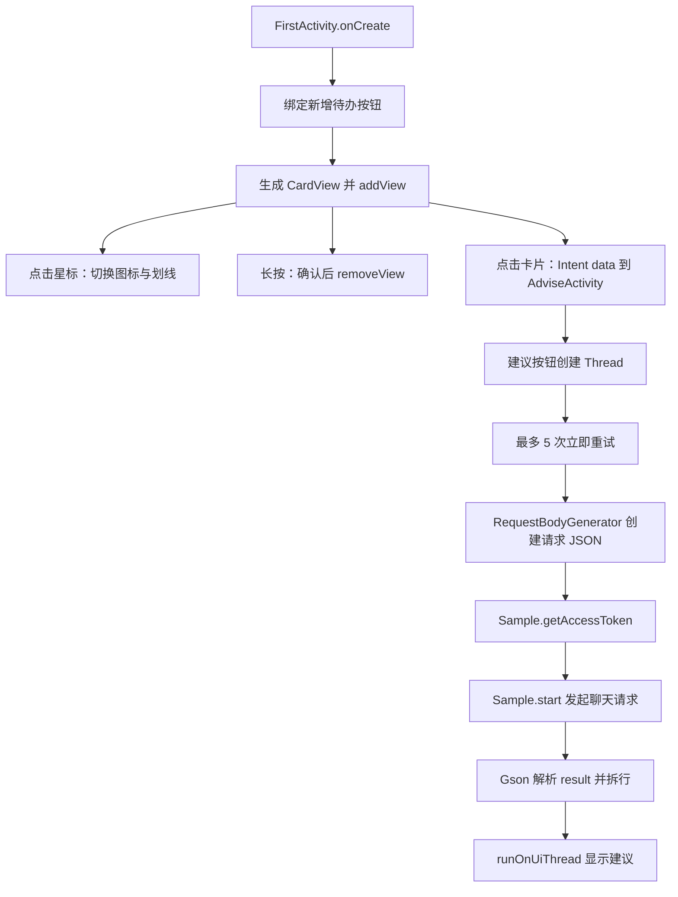

# 补充项目、frontend 与工程化审查

分析日期：2026-10-23。本文作为项目 REA 总报告的补充，覆盖 SmartTodo-NoteCraft、实际 frontend 工作树、启动脚本、浏览器预览和测试资产。未修改产品代码，未启动模拟器，未调用百度接口。

## 1. 证据边界与可复现性

本次用常规源代码工具检查源码，用 Android SDK `aapt2 36.0.0` 检查补充 APK 的真实清单，用本地 DEX 格式解析读取所有 `class_defs`。这些结果属于本机静态证据，不冒充 REA Evidence ID；JADX/REA 的主 APK 证据见总报告。

- [原始静态检查记录](<D:/SE/软件工程项目实验/交付物/REA分析/证据/supplement-source-package-audit.json>)：含 APK 哈希、清单摘要、DEX 类定义、启动检查结果、frontend 提交及工作树状态。密钥只保留“是否存在”的布尔值。
- [可复现检查脚本](<D:/SE/软件工程项目实验/交付物/REA分析/supplement_audit.py>)：只读目标文件；仅将分析结果写入本报告旁的证据目录。包含针对本机 SDK 的路径，需要换机时调整。
- 补充 APK：`D:\SE\软件工程项目实验\补充文件\SmartTodo-NoteCraft\Smarttodo-NoteCraft\app\build\outputs\apk\debug\app-debug.apk`，7,061,520 字节，SHA-256 `A0F12DA890DE40F943AAE831D14C953211E1102E2E3F569ED9D58D63DFA4246F`。
- 包内共 6 个 DEX，分别为 `classes.dex` 至 `classes6.dex`。本地 DEX 解析验证了类定义，不包含方法反编译或运行时加载验证。
- 源码与此 APK 有差异：源码有 `net.micode.notecraft.MainActivity`，该类在包内无定义。因此方法级源码发现均明确标为源码事实；不能直接将整个源码目录等同于 APK 构建输入。

## 2. SmartTodo-NoteCraft 的实际实现

路径：`D:\SE\软件工程项目实验\补充文件\SmartTodo-NoteCraft\Smarttodo-NoteCraft`。这是独立的原生 Android 待办/AI 建议演示程序；没有证据证明它已与 MiCode Notes 的数据库或主交付 APK 集成。

| 项目 | 静态观察 |
|---|---|
| APK 包名 | `com.example.emptyactivity` |
| 展示名称 | 智慧待办 |
| SDK | minSdk 24、targetSdk 34、compileSdk 34 |
| 网络 | OkHttp 4.12.0，直接调用百度 OAuth 和聊天接口 |
| 请求序列化 | Moshi 创建请求 JSON，Gson 解析响应 |
| 待办状态 | `LinearLayout` 动态添加、移除卡片；完成状态保存在 View 中 |
| 辅助页面 | `SecondActivity` 点击计数、音效、轮换图片 |
| 权限 | INTERNET、VIBRATE；APK 还含 AndroidX 的动态 Receiver 内部权限 |

调用链如下，箭头表示源码中存在的直接调用或事件处理关系，不表示本次执行过：

### 2.1 P1：密钥同时出现在源码与 APK 中

[Sample.java](<D:/SE/软件工程项目实验/补充文件/SmartTodo-NoteCraft/Smarttodo-NoteCraft/app/src/main/java/baidu/com/Sample.java:15>) 的第 15、16 行为非空 API_KEY、SECRET_KEY 常量。检查脚本在不打印值的情况下验证了这两个字面量均存在于全部 APK DEX 的搜索范围内，结果为 true。

影响：得到 APK 的人可以提取应用持有的接口凭据；把它们移到客户端配置或资源中仍会随包分发。建议撤销/轮换现有凭据，将需要保密的上游鉴权放到服务端；客户端仅使用受控的应用会话。是否仍有效、是否被滥用、配额和权限大小均未联网验证。

### 2.2 P1：APK 含有不存在的启动 Activity

[AndroidManifest.xml](<D:/SE/软件工程项目实验/补充文件/SmartTodo-NoteCraft/Smarttodo-NoteCraft/app/src/main/AndroidManifest.xml:18>) 同时给 `.MainActivity` 和 `.FirstActivity` 声明了 MAIN/LAUNCHER。实际 APK 的 `aapt2 dump badging` 也返回两个启动入口：

| 清单入口 | 全部 DEX 中是否有对应类定义 |
|---|---|
| `com.example.emptyactivity.MainActivity` | 否 |
| `com.example.emptyactivity.FirstActivity` | 是 |

包内实际存在的是 `net.micode.myapplication.MainActivity`。源码两份 MainActivity 也分别位于 `net.micode.myapplication` 和 `net.micode.notecraft`，均非清单解析出的类名。没有发现自定义 Application/DexClassLoader 等用于补足此入口的证据。

结论：存在配置不一致的启动入口；按普通 Android 类加载方式，尝试进入缺失类会失败。由于没有实际点击启动器，本报告不虚构崩溃日志，也不声称所有启动方式都会失败；`FirstActivity` 是独立存在的有效类。建议只保留产品需要的一个正确入口，并在设备上验证启动图标与显式启动。

### 2.3 P1：待办事项没有持久化或重建恢复

[FirstActivity.java](<D:/SE/软件工程项目实验/补充文件/SmartTodo-NoteCraft/Smarttodo-NoteCraft/app/src/main/java/com/example/emptyactivity/FirstActivity.java:101>) 的添加路径创建 CardView，第 174 行仅 `todo_list.addView(cardView)`；删除路径第 188 行仅 `removeView`；完成状态第 138 行起只改 Drawable 和 TextView 的划线标志。该类未覆盖 `onSaveInstanceState` 以保存这些动态数据，也未使用数据库、文件、SharedPreferences 或 ViewModel 保存待办列表。

搜索边界为本项目 `app/src/main/java` 下全部 8 个 Java 文件，未找到待办仓储、持久化模型或与 MiCode ContentProvider 的联接。静态计数 `todo_item_count` 也仅递增且没有驱动持久化。

影响：进程结束或 Activity 重建后无法从此代码恢复新增待办、完成状态和删除结果。建议先定义稳定 ID、内容、完成状态等模型，以 Room/SQLite 持久化，再让界面渲染数据。AI 建议也没有写回笔记或子任务的持久化路径。

### 2.4 P2：重复请求、共享响应及生命周期不受控

真实可达路径位于 [AdviseActivity.java](<D:/SE/软件工程项目实验/补充文件/SmartTodo-NoteCraft/Smarttodo-NoteCraft/app/src/main/java/com/example/emptyactivity/AdviseActivity.java:56>)：第 62 行每次点击都创建一个新 Thread；第 67 行最多重试 5 次，没有退避、按钮禁用、去重或取消机制。离开页面后线程仍可能通过 `runOnUiThread` 捕获旧 Activity、TextView 和 MediaPlayer。

[Sample.java](<D:/SE/软件工程项目实验/补充文件/SmartTodo-NoteCraft/Smarttodo-NoteCraft/app/src/main/java/baidu/com/Sample.java:20>) 的 `Response_string` 是进程共享的静态变量；第 33 行赋值后，第 46 行又从该共享变量解析。两个并发请求可以在赋值与解析之间交错，使某次请求解析另一次响应。这是源代码上的竞态条件，不等于已经观察到用户数据混串。

每次 `start` 都先请求 OAuth token，再请求聊天接口；持续失败的一个点击最多进入 5 次尝试，实际网络请求总数取决于每次在哪个阶段失败。建议缓存有效期内的 token、使用局部响应变量，并让受生命周期管理的异步任务负责取消与状态更新。

特别澄清：[FirstActivity.java](<D:/SE/软件工程项目实验/补充文件/SmartTodo-NoteCraft/Smarttodo-NoteCraft/app/src/main/java/com/example/emptyactivity/FirstActivity.java:51>) 第 52 行的多参 `onClickGetAdvice` 绑定已被注释，第 53 行实际绑定单参重载，它只显示提示。不能把第 219 行起那套旧重试实现当作主页已接入的调用链。

### 2.5 P2：响应校验不足，错误与日志处理粗糙

[Sample.java](<D:/SE/软件工程项目实验/补充文件/SmartTodo-NoteCraft/Smarttodo-NoteCraft/app/src/main/java/baidu/com/Sample.java:32>) 两个 HTTP 路径都直接读取 body，不检查 HTTP 成功状态、响应业务错误、token 缺失或 `result` 为空。第 58 行直接对 result 调用 split；接口返回错误 JSON 时可出现异常，并被 UI 统一视为可立即重试的错误。永久鉴权失败和限流不应与短暂网络故障采用相同策略。

第 34 行 `System.out.println(Response_string)` 输出完整聊天响应，可能把包含用户任务信息的生成结果写入调试日志。建议只记录脱敏的错误码/请求关联 ID，并在展示前验证结构与业务状态。

资源处理边界：OkHttp `ResponseBody.string()` 会读取并关闭响应体，不能仅凭没有 `response.close()` 就认定此处正常路径泄漏。建议使用明确的作用域关闭结构提升异常路径可读性，但本报告不将这一点列为已证实的连接泄漏。

### 2.6 P2：MediaPlayer 没有释放

FirstActivity 第 39、40 行创建两个播放器；[AdviseActivity](<D:/SE/软件工程项目实验/补充文件/SmartTodo-NoteCraft/Smarttodo-NoteCraft/app/src/main/java/com/example/emptyactivity/AdviseActivity.java:40>) 创建一个；[SecondActivity](<D:/SE/软件工程项目实验/补充文件/SmartTodo-NoteCraft/Smarttodo-NoteCraft/app/src/main/java/com/example/emptyactivity/SecondActivity.java:31>) 又创建一个。三类均未实现释放播放器的生命周期处理，源码中未找到对应 `release()`。FirstActivity 的 bling 播放器还未接入当前有效按钮回调。建议按页面生命周期释放，或用适合短音效的集中式方案。

### 2.7 P2：构建与测试资产存在未清理的模板残留

- [app/build.gradle](<D:/SE/软件工程项目实验/补充文件/SmartTodo-NoteCraft/Smarttodo-NoteCraft/app/build.gradle:6>) 使用 `com.example.emptyactivity`；并存的 [app/build.gradle.kts](<D:/SE/软件工程项目实验/补充文件/SmartTodo-NoteCraft/Smarttodo-NoteCraft/app/build.gradle.kts:5>) 写的是 `net.micode.myapplication`，没有 plugins/dependencies 配置。APK 包名与 Groovy 文件一致。未发现显式 `buildFileName` 切换配置；不把并存本身描述为随机选择构建。
- [settings.gradle](<D:/SE/软件工程项目实验/补充文件/SmartTodo-NoteCraft/Smarttodo-NoteCraft/settings.gradle:22>) 重复包含 `:app` 五次，另有 Kotlin settings 文件。建议只保留维护中的一套配置，去除错误 package 和重复模块声明。
- 3 个本地单元测试均为 `2 + 2 == 4` 模板，不覆盖待办恢复、响应错误、并发、鉴权或 Activity 入口。
- 默认 `src/androidTest` 下的 [ExampleInstrumentedTest.java](<D:/SE/软件工程项目实验/补充文件/SmartTodo-NoteCraft/Smarttodo-NoteCraft/app/src/androidTest/java/net/micode/myapplication/ExampleInstrumentedTest.java:24>) 断言包名为 `net.micode.myapplication`，与实际 APK 的 `com.example.emptyactivity` 不符；当前配置运行该断言预期会失败，本次未实际执行设备测试。
- 另 3 个测试放在 `src/androidTest_notecraft`，没有发现将其映射为测试 sourceSet 的配置，因此不能计为默认 instrumentation test 的覆盖。

## 3. frontend 实际位置、版本和实现

frontend 并非独立 React/Vue 页面；它是 MiCode Notes 的原生 Android 中文界面分支。全工作区检索自有源码与配置并排除 Gradle 缓存、构建目录、第三方 HttpClient Javadoc 后，未发现 package.json 或独立 Web 应用工程。唯一浏览器页面嵌在临时预览脚本中，用于转发真实模拟器画面。

| 工作树 | 分支 | 检查时提交 |
|---|---|---|
| `D:\SE\软件工程项目实验\.work\CSU_SE_TEST\repo` | frontend | `9ce569894ef26d1a5e6365703f8eb2bba616be04` |
| `D:\SE\软件工程项目实验\.work\CSU_SE_TEST\code-optimization-zh` | code-optimization-zh | `3057dc9` |
| `D:\SE\软件工程项目实验\.work\CSU_SE_TEST\feature-expansion` | feature-expansion | `9ce5698` |

frontend 工作树 `git status --short` 为空；本地 `origin/frontend` 同为 `9ce5698`。这只说明已缓存远程引用与本地一致，没有本次联网查询远端最新状态。frontend 提交时间为 2026-10-16 22:34:05 +0800。

语言选择调用链：

1. [NotesApplication.attachBaseContext](<D:/SE/软件工程项目实验/.work/CSU_SE_TEST/repo/app/src/main/java/net/micode/notes/NotesApplication.java:11>) 调用 AppLanguage.initialize 和 wrap。
2. [AppLanguage](<D:/SE/软件工程项目实验/.work/CSU_SE_TEST/repo/app/src/main/java/net/micode/notes/tool/AppLanguage.java:23>) 默认 `zh-CN`；API 33+ 使用 LocaleManager、保留 Android 已保存的非空语言；旧版本把选择放入私有 SharedPreferences。
3. [LocalizedActivity](<D:/SE/软件工程项目实验/.work/CSU_SE_TEST/repo/app/src/main/java/net/micode/notes/ui/LocalizedActivity.java:15>) 包装 Activity Context；旧版本在 onResume 比较语言并 recreate。
4. NotesPreferenceActivity 第 91 行起设置新语言，第 222 行更新选项；NoteEditActivity 第 309 行起保存工作笔记 ID，第 788 行调用 saveNote。这些构成编辑内容跨语言重建的设计路径；实际保存正确性仍需设备回归。

[README.zh-CN.md](<D:/SE/软件工程项目实验/.work/CSU_SE_TEST/repo/README.zh-CN.md:46>) 和变更记录记载了 2026-10-16 的 API 37 构建、语言切换和编辑保存回归，目录中保留 3 张截图。它们属于历史执行记录，本轮未重新运行。原记录明确 API 21–32、同步、导出、提醒、小组件尚未纳入该轮验收，应继续保留这些缺口，不把“中文版验证通过”扩大成所有功能验证通过。

### 3.1 frontend 输入与生命周期风险

**P2，外部搜索参数未校验。** frontend 清单将 NoteEditActivity 声明为 exported、singleTop。其 [initActivityState](<D:/SE/软件工程项目实验/.work/CSU_SE_TEST/repo/app/src/main/java/net/micode/notes/ui/NoteEditActivity.java:182>) 在存在 `SearchManager.EXTRA_DATA_KEY` 时直接 `Long.parseLong`，没有捕获格式/溢出错误。外部应用可构造显式 ACTION_VIEW Intent 并提供非数字值，导致初始化抛异常。应以受控方式解析并对无效 ID 返回错误。这里确认的是源码路径与 Android 入口声明；未实际注入 Intent，也不将其描述为内容提供器数据泄露。

**P2，失败的新 Intent 与空模型存在生命周期风险。** 同类第 303 行 `onNewIntent` 忽略 `initActivityState` 的返回值；初始化首先清空 mWorkingNote，在 action 或 ID 无效时 finish。第 388 行 onPause 无空判断调用 saveNote，而后者直接 getWorkingText 访问模型。因此需重点验证“编辑页已在前台时，通过 singleTop 送入无效 Intent”的失败路径，增加状态检查与安全退出。仅在 onCreate 中 finish 不足以证明必然走到 onPause，本报告不将该情形直接当作已复现崩溃。

**语言恢复方案的边界。** 正常路径并非只依赖 Bundle 保留全文：onPause 将文本同步到 WorkingNote 再保存数据库，Bundle 只保存 noteId，onCreate 据 ID 重新加载模型。`onSaveInstanceState` 只对尚未入库的新便签先保存，既有便签依赖 onPause 保存；代码没有向用户呈现保存失败状态。需要用已有笔记、新建笔记、清单模式分别验证语言重建和失败保存场景。未发现足够证据证明一般语言切换必然丢数据。

### 3.2 主 APK 中应核对的 frontend 方法

| 类 | 需要核对的方法/状态 |
|---|---|
| `net.micode.notes.NotesApplication` | attachBaseContext、onConfigurationChanged |
| `net.micode.notes.tool.AppLanguage` | initialize、getLanguage、setLanguage、wrap、selectedConfiguration |
| `net.micode.notes.ui.LocalizedActivity` | attachBaseContext、onCreate、onResume |
| `net.micode.notes.ui.NotesPreferenceActivity` | onCreate 的语言监听器、refreshUI |
| `net.micode.notes.ui.NoteEditActivity` | onCreate、initActivityState、onNewIntent、onSaveInstanceState、onPause、getWorkingText、saveNote |

判断同版本需同时核对方法内容和资源/清单，仅存在同名类不足以证明 APK 来自 frontend 当前提交。原始检查 JSON 另保存本次涉及的 SmartTodo/ frontend Java 文件及脚本 SHA-256，用于后续对照行号对应的文件版本。

### 3.3 已确定的 APK 文件对应关系

本次只检查下表明确列出的 `app/build/outputs/apk/debug/app-debug.apk`，没有遍历 Gradle 缓存或搜索其他 APK。[哈希匹配原始记录](<D:/SE/软件工程项目实验/交付物/REA分析/证据/apk-worktree-hash-match.json>) 保留绝对路径、长度和完整 SHA-256。

| APK 位置 | 字节数 | SHA-256 / 与交付包关系 |
|---|---:|---|
| `交付物/安装包/便签-中文版-debug.apk` | 2,073,474 | `9C52E2508A8E021F6F7C208C7B0FE5E5418C6EF8D9FCCF8A9AB4203A34E3C250` |
| `.work/CSU_SE_TEST/repo/app/build/outputs/apk/debug/app-debug.apk` | 2,073,474 | **与交付 APK 相同 SHA-256** |
| `.work/CSU_SE_TEST/code-optimization-zh/app/build/outputs/apk/debug/app-debug.apk` | 1,985,907 | `83751122345B20AF4677904B721C727D86BA318FCA39E7056C14D4BE2919AF6F`，不同 |
| `.work/CSU_SE_TEST/feature-expansion/app/build/outputs/apk/debug/app-debug.apk` | — | 此明确位置不存在 APK |
| `源码/MiCode-Notes/app/build/outputs/apk/debug/app-debug.apk` | 2,018,598 | `84F1FD64308ADCCBFA61EA466CF5A462186DBCEC1FEB1FECFA8293ABA5EABE09`，不同 |

因此交付 APK 与 frontend 工作树现存构建输出是同一份内容，不能把根目录 `源码/MiCode-Notes` 的 APK 当成交付版本。源码主目录当前有 39 个 Java 文件，frontend 则有 42 个；`NotesApplication`、`AppLanguage`、`LocalizedActivity` 三个新增文件在前者均不存在、在后者均存在。39 文件版本不能解释交付包内的这些新增功能。该匹配确立了文件身份与源码候选范围；由于本轮未做可复现重建，不把本地输出文件的存在当成“已证明该 commit 一定产生该二进制”的完整供应链证明。

### 3.4 课程与操作文档存在版本漂移

本轮保留原文档，仅登记与当前文件树冲突的位置，避免把历史阶段说明当作现状。

| 文档位置 | 旧描述 | 当前证据 / 使用建议 |
|---|---|---|
| [你需要完成的部分.md:56](<D:/SE/软件工程项目实验/你需要完成的部分.md:56>) | 源码没有构建脚本、不能直接 Open，必须新建空工程搬代码 | 主源码已有 settings.gradle、build.gradle、app/build.gradle、gradlew.bat；按当前 Gradle 工程打开 |
| [你需要完成的部分.md:58](<D:/SE/软件工程项目实验/你需要完成的部分.md:58>) | `源码/MiCode-Notes/src/net/...`，并指定旧方法行号 | 实际 Java 根为 `app/src/main/java`；版本变化后需重新定位方法，不能照抄行号 |
| [安卓环境搭建与运行手册.md:21](<D:/SE/软件工程项目实验/安卓环境搭建与运行手册.md:21>) | 仓库只有 src/res/AndroidManifest.xml | 属于 Eclipse 原始快照阶段，不适用于当前已迁移目录 |
| [安卓环境搭建与运行手册.md:162](<D:/SE/软件工程项目实验/安卓环境搭建与运行手册.md:162>) | 从旧 `src/net` 拷贝创建新工程 | 对现目录路径无效；不应再次搬迁已存在的 Gradle 工程 |
| [安卓环境搭建与运行手册.md:425](<D:/SE/软件工程项目实验/安卓环境搭建与运行手册.md:425>) | “源码无构建脚本已核实”；末尾说没有 Android 环境、跑不了构建 | 后续已有 APK、AVD 和历史验证记录，本轮 CheckOnly 也通过；旧结论有明确时间边界 |
| [项目拉起操作手册.md:12](<D:/SE/软件工程项目实验/项目拉起操作手册.md:12>) | 明确说明无构建脚本的说法已过时，提供当前 Gradle 结构 | 该手册是当前主源码启动的较新入口；frontend 则以其 README.zh-CN.md 和实际工作树为准 |
| [你需要完成的部分.md:153](<D:/SE/软件工程项目实验/你需要完成的部分.md:153>) | 将 `.work` 概括为中间产物、除 classes.json 外可删除 | `.work` 当前实际承载 frontend Git 工作树、AVD 和预览服务；清理前必须按现有用途核查 |

课程平台、小组人数和提交规范中的历史冲突需要教师或团队确认；仅凭代码/二进制分析无法替代这些外部事实。上述文档漂移不影响历史记录作为过程材料保留，但会影响按文档操作和交付版本定位，建议后续建立一份带日期、分支、源码根和 APK 哈希的统一入口。

## 4. 启动脚本与浏览器预览

### 4.1 一键启动脚本

[start-chinese-notes.ps1](<D:/SE/软件工程项目实验/start-chinese-notes.ps1:1>) 当前流程清楚：SDK 候选定位 → 检查 adb/emulator/AVD/APK → 同名模拟器校验 → 正常关闭旧同名设备 → 启动可见窗口 → 等待 boot_completed → `adb install -r` → 启动 NotesListActivity → dumpsys 检查前台。

当前静态优点：从 PSScriptRoot 定位项目；有 30–1800 秒启动超时；固定 serial 可防止安装到其他设备；关闭旧设备前核对 AVD 名；命令失败会中断；日志写入工作区。CMD 入口转发参数并返回 PowerShell 退出码。

本轮执行 `-CheckOnly` **退出 0**，确认当前 SDK 工具、两份 AVD 配置和交付 APK 文件存在。该检查在第 53 行结束，未启动 adb、模拟器或安装 APK。因此它不证明系统镜像、虚拟化、GUI 可见性、安装签名兼容性和完整启动流程已成功。依赖 `.work/zh-android/avd`，复制脚本到另一台机器不能自动搭建环境。

### 4.2 临时浏览器预览

实际文件：[.work/android-preview/server.py](<D:/SE/软件工程项目实验/.work/android-preview/server.py:1>)。它通过 adb screencap 获取模拟器 PNG，转换 JPEG，在 `127.0.0.1:8765` 提供页面与手势转发。不是将 Android UI 重写成 Web；页面上的 `frontend · 9ce5698` 也是静态文本，不能证明当前安装包就是该提交。

源码正面边界：仅监听回环地址；POST 校验 Origin；动作是固定的 back/keyboard/launch/gesture；坐标和手势时长有界；subprocess 使用参数列表、不拼接 shell。Python AST 解析本轮通过，服务未启动。

已确认的局限：

- **P2，断连后显示旧画面为已连接。** capture 异常只更新 ERROR（第 65 行），不清除 FRAME；`/frame` 只看 FRAME 是否非空（第 88 行），`/health.connected` 也只看这个条件（第 93 行）。成功连接一次后，即使后续采集失败，旧 JPEG 仍会返回 200，页面第 45 行继续显示“已连接”。建议记录帧时间戳，以时效和最近采集结果判断连接；旧帧可保留，但需要明确标识过期。
- **P2，可移植性不足。** ADB 绝对路径、serial、1080×2400 坐标与 8765 端口硬编码（第 11–16 行、41 行、133 行）。分辨率变化会造成点击映射不正确，换机需要人工修改。建议通过参数和 `wm size` 动态配置。
- **工程边界。** `.work` 为临时资产，预览进程没有随产品打包。原变更记录只验证了当时 localhost 请求与操作转发，没有承诺服务永久运行；本轮没有将历史服务状态当作当前运行事实。

## 5. 测试覆盖、优先次序与剩余问题

本轮新增的验证是：SmartTodo APK 哈希/清单/全 DEX 类定义检查、源码密钥与包内字面量存在性布尔检查、frontend 提交及工作树检查、预览 Python AST、启动脚本 CheckOnly。没有为本次只读分析改写产品测试，也没有用模板测试通过冒充业务验证。

建议修复顺序：

1. 轮换已打包凭据，迁出服务端秘密；修正不存在的 MainActivity 启动入口。
2. 明确 SmartTodo 与主便签的产品关系，先实现待办数据持久化和重建恢复，再讨论 AI 子任务整合。
3. 将网络层改为局部响应状态，加入结构化错误、生命周期取消、请求去重和有条件退避；补充 token 缓存与日志脱敏。
4. 释放 MediaPlayer，清理冲突构建配置和陈旧 package 测试；修正预览连接状态和参数化配置。
5. 在主便签开展低版本语言切换、编辑恢复、导出、提醒、重启提醒、小组件和同步回归；在 SmartTodo 覆盖进程重建、多个并发点击、401/429/5xx、空响应及离开页面等场景。

尚未解决的证据问题：补充 APK 方法实现是否与当前源码完全一致；缺失启动类在真实设备的错误日志；百度 API 当前有效性与返回契约；旧 Android 语言行为；全部业务功能的设备端运行结果。以上均不影响已经确认的包名/入口类不一致和凭据实际打包事实。
